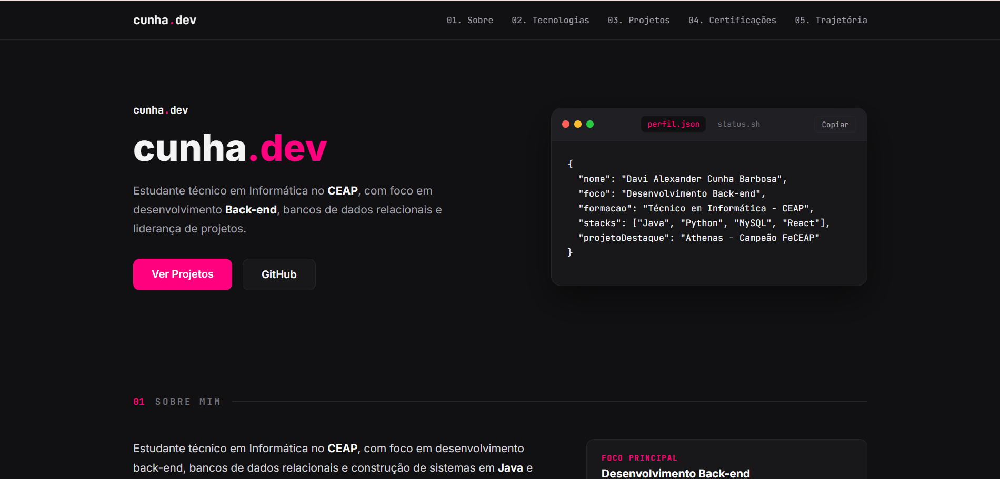

# cunha.dev

Portfólio pessoal desenvolvido em React para apresentação de projetos, formação acadêmica, certificações e tecnologias utilizadas no desenvolvimento de software.

## Demonstração

<video src="prints/davi-cunha-portfolio-video.mp4" controls width="100%"></video>

## Telas

### Início e terminal

### Projetos com filtro

### Certificações e formação

## Funcionalidades

**Terminal interativo**
- Alternância entre as abas `perfil.json` e `status.sh` por meio de estado
- Botão para copiar o conteúdo exibido no terminal para a área de transferência, com confirmação visual temporária

**Projetos**
- Listagem de projetos com imagem, descrição, tecnologias e links para código ou demonstração
- Filtro por categoria em tempo real (todos os projetos ou categorias específicas)

**Tecnologias, certificações e formação**
- Grade com ícones das linguagens, bancos de dados e ferramentas utilizadas
- Exibição dos certificados concluídos e da linha do tempo de formação acadêmica
- Navegação por âncoras no cabeçalho para cada seção da página

## Tecnologias

- React
- Vite
- JavaScript
- CSS Modules
- React Icons

## Como rodar

### 1. Pré-requisitos
- Node.js instalado
- npm

### 2. Instalar as dependências
Na pasta raiz do projeto, execute o comando abaixo para instalar o React, o Vite e a biblioteca `react-icons`:

npm install

### 3. Executar
Inicie o servidor de desenvolvimento:

npm run dev

Acesse `http://localhost:5173` no navegador.

## Arquitetura

O projeto organiza a interface em componentes reutilizáveis, separando os dados estáticos dos elementos visuais:

src/
├── assets/          # imagens dos projetos e certificados
├── components/
│   ├── layout/      # cabeçalho (Navbar) e rodapé (Footer)
│   ├── projects/    # card e barra de filtro de projetos
│   ├── sections/    # seções da página (Hero, About, Technologies, Projects, Certificates, Education)
│   └── ui/          # componente do terminal interativo
├── data/            # listas estruturadas de projetos e certificados
├── pages/           # composição da página principal (Home)
└── styles/          # variáveis CSS globais e reset

Fluxo principal: a página `Home` reúne as seções da aplicação, enquanto os componentes `Projects` e `TerminalCard` gerenciam a interatividade da tela com `useState`.

## Próximos passos

- Adicionar visualização ampliada (modal) para os certificados
- Criar formulário de contato funcional
- Adicionar alternância de idioma entre português e inglês

## Autor

Davi Alexander Cunha Barbosa
[GitHub](https://github.com/Davialexander0310) | [LinkedIn](https://linkedin.com/in/davi-alexander-cunha-barbosa)
