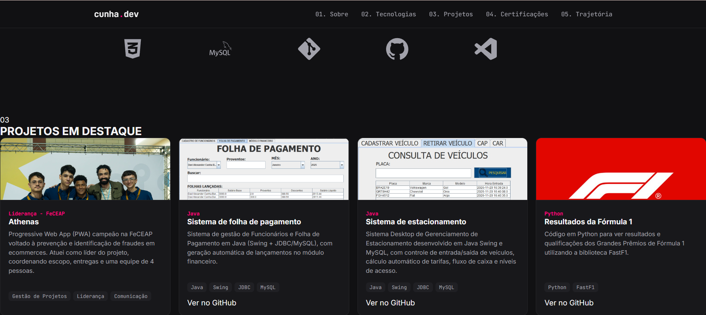
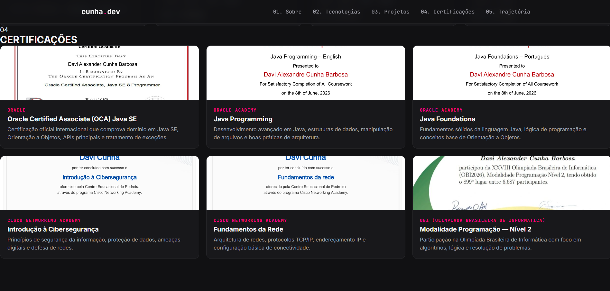

# cunha.dev

Portfólio pessoal desenvolvido em React para apresentação de projetos, formação acadêmica, certificações e tecnologias utilizadas no desenvolvimento de software.

## Demonstração

Clique na imagem acima para abrir o vídeo de demonstração.

## Telas

### Início e terminal

### Projetos com filtro

### Certificações e formação

## Funcionalidades

**Terminal interativo**
- Alternância entre as abas `perfil.json` e `status.sh` por meio de estado
- Botão para copiar o conteúdo exibido no terminal para a área de transferência, com confirmação visual temporária

**Projetos**
- Listagem de projetos com imagem, descrição, tecnologias e links para código ou demonstração
- Filtro por categoria em tempo real (todos os projetos ou categorias específicas)

**Tecnologias, certificações e formação**
- Grade com ícones das linguagens, bancos de dados e ferramentas utilizadas
- Exibição dos certificados concluídos e da linha do tempo de formação acadêmica
- Navegação por âncoras no cabeçalho para cada seção da página

## Tecnologias

- React
- Vite
- JavaScript
- CSS Modules
- React Icons

## Como rodar

### 1. Pré-requisitos
- Node.js instalado
- npm

### 2. Instalar as dependências
Na pasta raiz do projeto, execute o comando abaixo para instalar o React, o Vite e a biblioteca `react-icons`:
